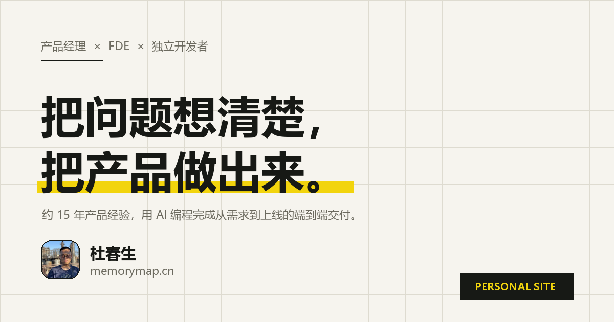
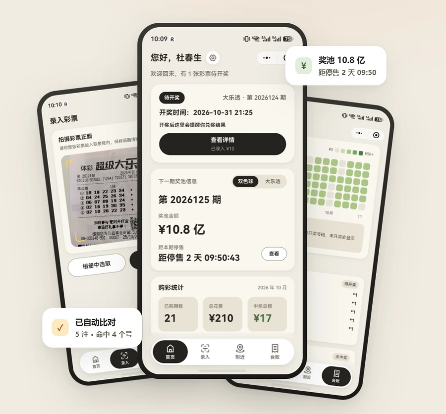
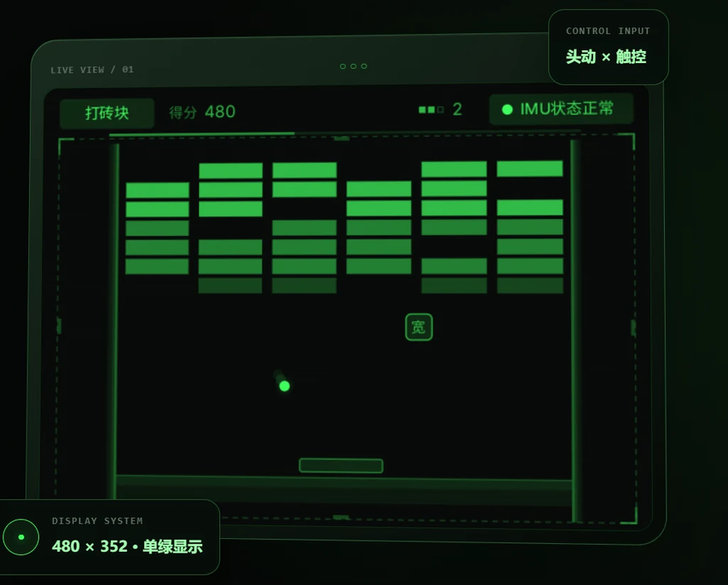
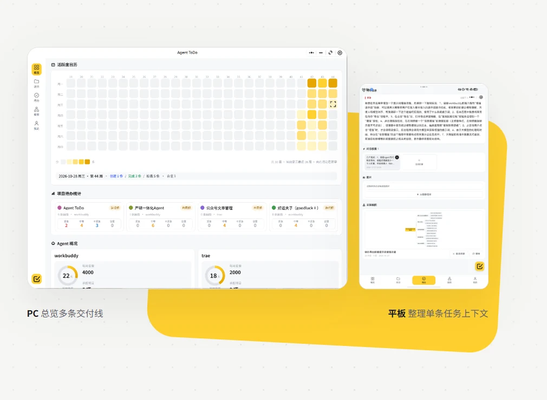

  

 

## 你好，我是杜春生

产品经理 × FDE（前沿部署工程师）× 独立开发者。

约 15 年产品经验，让我习惯先理解业务与用户；现在借 AI 编程把能力延伸到开发、测试与上线——**把问题想清楚，把产品做出来。**

我不太用技术名词介绍自己，更愿意直接给你看产品。

---

## 独立产品

三款已成型的产品，各自从一个具体问题开始。

<table>
  <tr>
    <td width="46%" valign="top">
      
    </td>
    <td width="54%" valign="top">
      <h3>01 · 好运夹 goodluck+</h3>
      
<code>微信小程序 · Rokid Glasses</code>

      
<strong>把彩票这件事，收进一个夹子里。</strong>

      <ul>
        <li>整张票拍照识别，支持手动校对</li>
        <li>双色球与大乐透开奖自动比对、逐球高亮</li>
        <li>60 日兑奖提醒与 12 周购彩台账</li>
        <li>手机与眼镜端共享同一份数据</li>
      </ul>
      
只做记录、核对与管理，不卖票、不代购。

      
<a href="https://lottery.memorymap.cn">lottery.memorymap.cn</a> ↗

    </td>
  </tr>
</table>

<table>
  <tr>
    <td width="46%" valign="top">
      
    </td>
    <td width="54%" valign="top">
      <h3>02 · 摇头晃脑</h3>
      
<code>Rokid Glasses · IMU 头控</code>

      
<strong>五款经典游戏，转头就能玩。</strong>

      <ul>
        <li>打砖块、接鸡蛋、滚球迷宫、导弹指挥部、打飞机</li>
        <li>头部动作控方向，轻点或滑动镜腿触控板操作</li>
        <li>三档灵敏度、本地战绩与操作音效</li>
        <li>单绿透明显示，围绕真实设备约束做设计</li>
      </ul>
      
交互不为炫技服务：所有操作都能在抬头状态下单手完成。

      
<a href="https://shake.memorymap.cn">shake.memorymap.cn</a> ↗

    </td>
  </tr>
</table>

<table>
  <tr>
    <td width="46%" valign="top">
      
    </td>
    <td width="54%" valign="top">
      <h3>03 · Agent-ToDo</h3>
      
<code>微信小程序 · 平板 · PC</code>

      
<strong>几个项目同时开着，别让哪一条断在半路。</strong>

      <ul>
        <li>语音、文字与截图形成闪念胶囊</li>
        <li>项目待办、四档紧急度与脑图方案</li>
        <li>导出含完整上下文的 Markdown 任务</li>
        <li>手机接住、平板整理、PC 派活</li>
      </ul>
      
公开入口为演示实例，正式交付按客户独立部署。

      
<a href="https://todo.memorymap.cn">todo.memorymap.cn</a> ↗ · <a href="https://todo.memorymap.cn/manual.html">操作手册</a>

    </td>
  </tr>
</table>

---

## 我怎么把一件事做完

从业务问题到可运行的产品，中间是这五步。第三、四步是我这些年新增的能力边界。

| 01 · 聊透需求 | 02 · 设计解法 | 03 · AI 协同开发 | 04 · 测试与上线 | 05 · 反馈与迭代 |
| :---: | :---: | :---: | :---: | :---: |
| DISCOVER | DEFINE | BUILD | SHIP | ITERATE |

我更在意的不是「用了什么模型」，而是**需求转译的损耗有没有减少**——让理解业务的人直接参与实现，让原始场景、约束与验收标准始终在同一条线上。

---

## 经历

| 时间 | 公司与组织 | 角色 |
| --- | --- | --- |
| 2020.04 — 至今 | 北明软件（北京） | 产品经理 |
| 2015.09 — 2019.12 | 微连锁（北京）科技 | 产品总监 |
| 2012.08 — 2015.08 | 富景天策（北京）气象科技 | 产品经理 |
| 2012.01 — 2012.08 | 凡客诚品 | 数据分析师 |
| 2008.07 — 2011.12 | 清华大学环境影响评价室 | 数据分析师 |

中国石油大学（北京） · 环境科学 · 2004—2008

企业侧参与过的项目：宝马中国（报价知识库 iQAF、Smart Handover 智能交接、CBW 客服系统）、上汽奥迪 Astro 中台、一汽丰田官方触点与 ADMS、江苏园博园票务与停车缴费、智能售货柜系统。

---

## 联系

<table>
  <tr>
    <td width="140" valign="middle" align="center">
      
    </td>
    <td valign="middle">
      
<strong>微信公众号：野生FDE老杜</strong>

      
合作咨询、产品试用与反馈都走这一个入口。关注后在公众号后台私信，附上具体场景与目标，我能更快给出判断。

      
个人主页：<a href="https://memorymap.cn">memorymap.cn</a>

    </td>
  </tr>
</table>

   
  把问题想清楚，把产品做出来 · THINK CLEARLY. BUILD REALLY.

